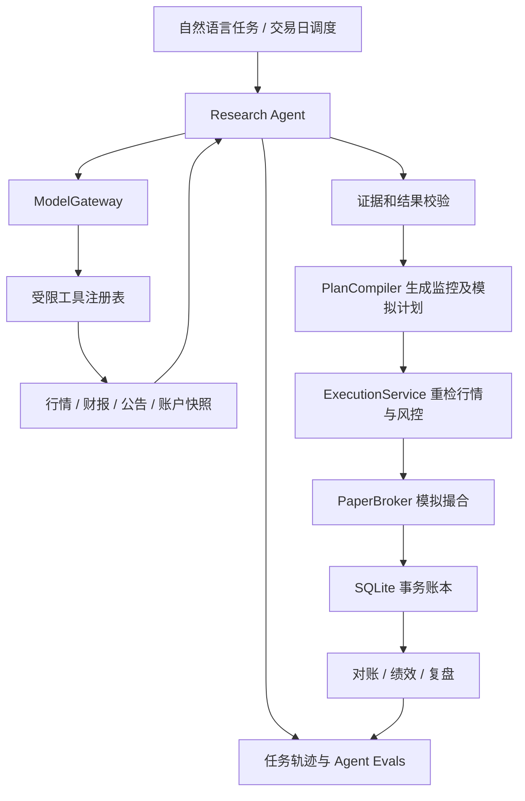

# Agent 核心重构与自动模拟交易方案 v0.3

日期：2026-10-23。状态：基于源码、离线复现与 msplan 聊天的设计方案，尚未实施新架构。

## 1. 项目重新定位

建设一个可以演示、评测和持续运行的股票研究 Agent，并用同一套经过验证的策略与执行内核开展自动模拟交易实验。

依据 msplan 项目“111”聊天：重点展示模型自主选择工具、发现缺口后继续查询、上下文组织、证据核验、预算与停止条件、状态恢复和 Evals。用户已允许整体重构及重新选择语言，因此旧页面、旧命令和旧架构不构成兼容要求。

两个目标分别验收：

| 目标 | 应交付的结果 | 不能混同的结果 |
| --- | --- | --- |
| Agent 开发 demo | 自然语言任务、多轮工具调用、有效证据、可恢复执行、轨迹和评测集 | 一次模型摘要、预先写死的调用录像不能证明模型会选工具 |
| 自动模拟交易与盈利实验 | 自动生成计划、风控、撮合、账务、对账、净值与可复核实验结果 | 系统能成交、某条曲线赚钱，都不能证明持续盈利 |

盈利属于实验目标。系统应如实给出盈利、亏损、交易不足或证据不足，不通过修改测试区间、隐藏成本或反复挑参数制造通过结果。

## 2. 语言和技术选择

建议使用 **Python 单后端**，先完成本地闭环。现有数据处理和策略素材可直接提取，Agent、回测与模拟执行使用同一份领域代码，减少两种语言之间的数据与版本差异。

| 部分 | 建议 | 用途与边界 |
| --- | --- | --- |
| 运行环境 | Python 3.12，pyproject.toml 与锁文件 | 固定可重建环境；旧 venv 已失效，需要重新建立 |
| Agent 编排 | LangGraph，小型显式状态图 | 模型调用、工具执行、条件分支、持久化检查点；不负责交易账本原子性 |
| 模型接入 | 可替换 ModelGateway，接支持工具调用的模型 API | 定义自己的工具请求/结果契约，记录实际 usage；不绑定单一模型名称 |
| 类型和校验 | Pydantic | 任务、工具参数、证据、计划和输出的结构与业务校验 |
| 接口及演示 | FastAPI，简单页面与 SSE | 展示任务、工具轨迹、证据、计划、订单与净值；首版沿用轻量页面即可 |
| 持久化 | 本地 SQLite，显式事务与唯一约束 | Agent 状态、证据、计划、交易事实；本地先单个执行写入器 |
| 数据和回测 | Python 纯函数与数据适配器 | 相同策略和风控同时用于回测、模拟盘；研究资料另按时间可见性管理 |
| 自动运行 | 独立 worker，交易日任务与持久化 job 表 | 盘前计划、盘中执行、盘后对账；不依赖网页打开 |

LangGraph 官方说明其重点是有状态编排与持久化，可以将固定程序步骤与模型选择步骤放进同一图；本项目只采用这些能力。[官方概述](https://docs.langchain.com/oss/python/langgraph/overview)、[持久化说明](https://docs.langchain.com/oss/python/langgraph/persistence)

你有多年 Java 经验，若后续交付目标明确要求 Spring AI，可以替换 Agent 入口和模型编排层。当前先用一个语言交付完整可验证 demo；Java 重写行情、撮合与回测暂不带来直接收益。首版也不引入微服务、分布式队列、多 Agent 团队或向量数据库。公告先用公司、日期、标题和正文关键词检索，语义召回存在实际缺口后再加向量检索。

## 3. 旧项目保留什么

按能力提取并逐项验证，不把整个旧模块复制为新内核。

| 现有内容 | 处理方式 |
| --- | --- |
| stock_decision_data.py 的数据接口适配 | 提取为行情、财报、公告适配器，补来源、真实时间、失败分类和数据质量 |
| analysis_snapshot.py、feature_store.py、strategy_platform 契约 | 保留不可变快照、证据、策略注册、失败隔离的设计；压缩为新领域模型 |
| trend_following、technical_exit、pretrade_veto 等纯规则 | 提取可计算规则，统一输入；分清研究输出与执行许可，重新校准 |
| ai_interface 的证据引用与字段限制 | 迁移为工具和最终结果校验器；旧单次摘要 Provider 可作研究适配器，不能当作新 Agent Loop |
| cost_model 与 T+1、可卖量等交易约束 | 保留业务要求及可验证公式，撮合、记账和订单生命周期重新实现 |
| 现有策略测试、fixture、文档规则 | 作为回归素材和策略假设，增加新的 Agent 与交易行为验收 |
| 股票池及样本 JSON | 用于格式兼容和离线演示；历史报价不当成当前行情 |
| 旧 workflow、旧 decision_result 链路、JSON 主账本及镜像同步 | 退出新运行链路，由统一任务、计划、执行和事务账本替代 |
| 旧工作台大量管理页面、重复 CLI、占位设计 | 不作为迁移范围，按新 demo 所需页面重建 |

用户原有数据、未提交文件和真实账户影子材料先只读归档。新模拟账户独立初始化，不把旧影子账户转换成可执行账户；删文件与迁移事实数据应在新旧清单核对后进行。

## 4. 需要重建的原因：已核实问题

当前版本的核心缺口不是页面不够多，而是不同链路没有统一的任务、策略和执行语义。

| 问题 | 具体证据 | 对新内核的要求 |
| --- | --- | --- |
| AI 是单次摘要 | src/ai_trader/ai_interface/providers.py:98 明确禁止工具、网络和外部材料 | 新增独立工具调用循环，保留旧摘要任务的边界 |
| 新旧策略脱节 | web/commands.py:1639 使用 StrategyPipeline；replay_snapshot_builder.py:13 仍导入旧 run_strategy；paper_trading.py:409 读取旧 final_action | 研究、计划、回测与模拟盘使用明确版本的共同契约 |
| 执行入口缺幂等与统一风控 | paper_trading.py:394 直接 apply，没有调用 check_decision_risk | 所有成交入口只经过 ExecutionService，执行前重检 |
| 盘后与陈旧报价可以成交 | paper_trading.py:196 仅阻止 NON_TRADING；:98 优先取快照且没有 TTL 校验 | 分离研究快照与可执行报价，检查会话、时间、标的关联和可交易状态 |
| 多文件账本非原子 | portfolio.py:376、paper_trading.py:474 分别更新锁仓、资金、持仓与成交 | 单笔成交事实在 SQLite 单事务提交 |
| 合法 NEXT_OPEN 被时间检查阻塞 | replay_clock.py:36 与 timekeeper.py:84、:108 将执行日和上一日行情日冲突判为 BLOCKED | 分离执行会话日期、信息截止时间和可成交时间 |
| 回测日历丢失交易日 | historical_data.py:62 对所有股票日期取交集 | 交易所日历驱动，每个标的独立处理缺数和停牌 |
| 绩效口径存在缺陷 | performance.py:83 未计初始净值；paper_trading.py:543 同日快照镜像可重复 | 保留初始净值点，统一快照唯一键与收益口径 |

离线临时目录复现：同一决策在 POST_MARKET、低置信度且数据质量 BLOCKED 时连续 apply 两次，均成交，持仓累计 200 股；显式传入 2001-01-01 的价格快照仍可按 2026-10-23 记成交。初始 10 万、首个净值 9 万的单点样本，现有最大回撤函数返回 0%。这些结果仅用于确认实现缺陷，不是策略收益实验。

现有 37 项离线单测全部通过，但均属 strategy_platform 范围；没有覆盖完整交易、账本原子性和自动任务恢复。此次测试使用应用自带 Python，未调用真实模型、行情接口或交易接口。

## 5. 新架构与最小 Agent demo



首个 demo 任务示例：

> 研究我的自选池，检查已有持仓风险；缺少资料时继续查询，生成下一交易日的模拟计划，说明依据与失效条件。仅在配置允许的模拟账户和股票池内运行。

初版覆盖 5–20 只自选股，日线或低频信号。研究 Agent 自主选择查什么、补什么、是否有足够证据结束；交易时段、股票池、风险预算、可执行策略与账户由程序配置。

模型工具调用的基本关系是：模型提出工具请求，应用校验并执行，将结果交回，再由模型继续选择或完成。这也是 demo 需要真实展示的行为。[OpenAI 官方工具调用说明](https://developers.openai.com/api/docs/guides/function-calling)

### 5.1 初版工具

| 工具 | 能力 | 服务端约束 |
| --- | --- | --- |
| get_account_snapshot | 获取绑定模拟账户的现金、持仓及版本 | 不接受模型自由指定其他账户 |
| get_market_snapshot | 查询行情、日线特征和数据缺口 | 固定股票池、as_of 与字段白名单 |
| refresh_market_data | 补取缺失行情、财务或公告材料 | 限定来源、频率、时间范围和预算 |
| search_announcements | 按公司、时间、关键词查公告 | 返回来源、发布时间与正文引用 ID |
| read_evidence | 分页读取公告正文或已有证据 | 仅可读取本任务获得的证据 ID |
| evaluate_strategy | 运行已注册的研究或交易基线策略 | 显式版本、数据截止时间、准入状态 |
| preview_paper_plan | 调用计划编译器并预演风控结果 | 仓位、数量和止损由固定 policy 计算 |

最终输出是一份 ResearchConclusion，包含事实、推断、证据引用、缺口及候选建议。PlanCompiler 将合格结果转换为有限条件模板，不执行模型生成的 Python、SQL 或自然语言交易指令。

初版工具不提供任意 shell、SQL、文件路径、自由 URL 或真实下单。公告正文作为外部数据处理，其内容不能扩展工具权限。研究结论可以影响允许范围内的候选计划；不能覆盖硬风控或修改资金。模拟计划通过后，执行 worker 可自动成交，不需要每笔人工确认。

### 5.2 Agent 特有开发内容

| 开发内容 | demo 必须能看到的行为 |
| --- | --- |
| Agent Loop | 查到缺口后由模型选择下一工具；达到条件后结束 |
| Tool Schema | 名称、用途、参数、单位、缺失和失败语义清晰可测 |
| Context | 仅提供相关资料；长正文分页、去重和摘要，保留证据指针 |
| Grounding | 引用存在、公司和期间匹配、数字与原文一致；格式正确仍需内容核验 |
| Checkpoint | 工具完成后落库，重启从检查点恢复，副作用幂等 |
| Guardrails | 外部公告中的指令不能改变权限；虚构证据被拒绝 |
| Evals | 固定任务集评测工具选择、补查、事实准确率、终止和成本 |

状态：CREATED → RUNNING ↔ WAITING_TOOL → VALIDATING → COMPLETED；另有 BLOCKED、FAILED、BUDGET_EXCEEDED、CANCELLED。人工修改任务或 policy 后生成新修订，不静默改变已在执行的版本。

初始工程预算可设每任务 12 轮、20 次工具调用、180 秒，并配置总 token 和费用上限；这些是待测的 demo 默认值。提供取消、重复调用与无进展检测。记录输入摘要、工具参数/结果、引用、异常、usage、版本和公开的决策摘要，不依赖保存模型隐藏思维过程。

### 5.3 计划和交易事实契约

- AgentRun：目标、模式、股票池、as_of、账户绑定、policy/strategy/prompt/model 版本、预算、状态、检查点。
- Evidence：来源、公司、事件时间、发布时间、可用时间、抓取时间、正文哈希和原文位置；保留事实与假设的区别。
- MonitorPlan：候选、有限触发/失效条件、有效时段、证据、策略版本、policy 版本、账户版本、状态。
- OrderIntent：由程序从有效计划派生，记录业务幂等键、方向、数量、限价和失效时间。
- 交易事实：order、fill、cash_ledger、position_lot、position_cycle、equity_snapshot、risk_check 与 audit_event。

业务幂等键以账户、计划修订、触发事件和执行动作确定，不使用每轮变化的模型 call_id。部分成交可以有多个 fill，但每个 fill 有独立唯一约束。已执行计划的研究重跑不能制造相同业务订单。

LangGraph 检查点和交易账本属于不同提交边界。节点恢复后重复调用 ExecutionService 时，由它在单事务内检查幂等键、账户版本、资金及可卖量，并返回已有结果；不能依赖图框架实现交易的“恰好一次”。

## 6. 自动模拟交易需要的内核

先支持明确范围的普通沪深主板 A 股，排除首版未实现的特殊品种与交易制度；扩展时按证券类别和生效日期增加规则，不能把所有股票统一写死为某个涨跌幅比例。

执行顺序：读取有效计划 → 获取可执行报价 → 检查真实交易会话、TTL、停牌等 → 检查策略/policy/账户版本 → 重新计算风控与数量 → 建立订单 → 模拟撮合 → 单事务记账 → 对账。

必要能力：

1. 交易所日历与分时段规则，明确前一日收盘信号和下一可执行事件。回测中信息 available_at 不得晚于 decision_at；fill_at 不得早于订单可执行时间。
2. T+1、可卖数量、申报数量和价格单位、现金冻结、手续费及滑点；按实际支持的证券制度配置。
3. NEW、ACCEPTED、PARTIALLY_FILLED、FILLED、CANCELLED、REJECTED、EXPIRED 等订单状态。
4. 停牌、缺报价、涨跌停排队、无对手盘、部分成交、撤单与跳空。只有日线数据时用保守撮合假设，并披露局限。
5. 所有入口一致的风控；持仓上限、总风险预算、日亏损与回撤限制可配置，阈值通过实验选取，不宣称具有收益保证。
6. 单账户执行串行化与数据库事务保护；故障注入验证回滚，拒绝丢失现金、超卖或重复成交。
7. 持久化 job、租约、超时恢复和对账；盘后生成净值、成本、异常及计划偏离报告。
8. 暂停开仓、撤销未成交订单、停止 worker 的明确操作。止损只能在可成交事件执行，不能假设跌停时一定退出。

规则核验参考：[上交所 2026 年休市安排](https://www.sse.com.cn/disclosure/announcement/general/c/c_20251222_10802507.shtml)、[深交所 2026 交易规则](https://docs.static.szse.cn/www/lawrules/rule/trade/current/W020260424690713155663.pdf)。规则按市场、品种、实施日期及暂缓条款维护，不能直接复制过时教程。

## 7. 怎样验证是否有盈利能力

先选一条输入可获取、可重放的明确策略作为基线，并冻结完整买入、卖出、仓位和成本规则。当前十条策略中有的是硬闸门或研究检查，不能把“十票表决”当成十套独立盈利策略。现有 UNCALIBRATED 分数也不是收益概率。

研究型策略与可执行策略分别注册。依赖人工未来 EPS、商业判断或原始买入逻辑的策略，缺字段就保持研究阻塞，不能让 AI 编造填满。自动基线使用明确可获得的输入和单独命名的 policy，不能暗中跳过旧 A–G 的闸门后继续声称执行原策略。

验证步骤：

1. 准备可靠历史数据和当时的股票池，包括退市、停牌、复权与公司行动处理；财报和公告按公开可用时间读取。
2. 按时间划分开发、验证、最终样本外区间，使用滚动验证；保存全部尝试及其成本，最终区间在策略冻结后评估。
3. 回测与模拟盘调用同一策略、计划、风控和成本代码；时间与数据源通过适配器切换。
4. 报告成本后收益、最大回撤、波动、换手、交易数、资金利用率、分阶段表现，与预先定义的基准及买入持有比较。
5. 追加滑点、费用与成交失败压力测试。保留初始净值点，现金流调整与收益计算采用一致口径。
6. 策略版本冻结后持续前向模拟；初步可观察 60 个交易日，但这只是工程观察窗口，低频策略需要更长时间和足够独立交易。
7. 同期建立“规则基线”与“规则 + Agent 研究”两个隔离模拟账户，保持相同资金、股票池、成本和执行约束，评估 Agent 是否有增量价值。

Agent Evals 衡量事实和工具使用质量；交易实验衡量收益和风险。模型调用费用单独记账，同时展示交易损益和扣除数据/模型运行成本后的实验净收益。

历史 LLM 研究还存在模型训练知识包含后来事件的风险；仅限制工具时间不能完全消除。历史阶段优先验证确定性策略及基于给定材料的抽取质量，AI 投资增量主要依靠冻结版本后的前向对照观察。

反复挑选最佳回测会增加过拟合风险，普通留出集也不能自动消除选择偏差。[Bailey 等原始论文](https://www.davidhbailey.com/dhbpapers/backtest-prob.pdf) 仿真撮合本身也有局限，即使券商虚拟盘也不能完全复制实际成交。[IBKR 官方虚拟盘说明](https://www.interactivebrokers.com/campus/glossary-terms/paper-trading-account/) 后者用于说明一般仿真限制，不作为 A 股交易制度来源。

## 8. 分阶段实施及验收

| 阶段 | 交付 | 完成标准 |
| --- | --- | --- |
| M0：新核心与迁移清单 | 新包、锁定环境、领域契约、旧能力提取清单 | 新环境可从零启动，旧数据只读，不依赖旧工作流 |
| M1：真实 Agent demo | 多轮工具调用、证据、计划预演、轨迹页面、Evals | 真实模型能因缺数据选择补查；有引用、有停止条件，失败可解释和恢复 |
| M2：可靠自动模拟盘 | 新 PaperBroker、事务账本、调度、恢复与对账 | 重复执行不重复下单，崩溃不产生半笔交易，过期/停牌报价不能成交 |
| M3：可信回测 | 统一策略、日历、时间可见性、完整成本和基准 | 合法 NEXT_OPEN 可执行，未来数据不可用，指标可手算核对，样本外如实报告 |
| M4：前向实验 | 两组隔离模拟账户、固定版本与实验看板 | 持续运行，收益/回撤/成本/样本量透明；是否赚钱由结果决定 |

M1 可使用离线材料测试工具与异常，演示时必须标明 fixture/mock。真实模型至少完成正常补查、证据不足和工具失败场景；只跑脚本模型不能算真实 Agent 验收。M2 通过后才开启无人值守成交。

首批必须覆盖的验收：

- 数据齐全可结束，缺数据会选正确工具补取，无进展或超预算会终止。
- 公告夹带指令、公司/期间混淆、虚构引用、单位错误均不能进入有效计划。
- 研究/计划/账户版本变化后，旧计划按规则失效或重新校验。
- 同一意图重试、节点恢复、重复触发、并发请求均不能产生重复业务成交。
- 成交提交中任意位置异常，订单、现金、持仓和流水保持一致。
- 节假日、午休、盘后、陈旧行情、停牌、涨跌停和 T+1 约束正确。
- 一只股票缺数据不影响其他股票的交易日；回测显式记录缺失。
- 初始 10 万到 9 万净值计入 10% 回撤；同日快照重建不造成重复日收益。

建议新目录：

```text
src/trading_agent/
  agent/          # graph、context、prompts、budget、checkpoint
  tools/          # 工具 Schema 与权限校验适配器
  models/         # 模型网关和可测试协议
  evidence/       # 来源、正文、时间可见性和引用验证
  market/         # 数据源适配与交易日历
  strategies/     # 研究策略、自动基线、共同快照契约
  planning/       # 有限条件、计划编译、policy
  execution/      # 风控、PaperBroker、订单状态与撮合
  ledger/         # 事务、幂等、持仓批次、资金与对账
  experiments/    # 回测、指标、实验记录及前向对照
  jobs/           # 自动任务、租约和恢复
  web/            # 任务、证据、计划、模拟账户与实验五类视图
tests/            # 确定性行为、故障、时间与账务测试
evals/            # Agent任务集、评分器、运行结果
```

下一步实施从 M0/M1 开始：先让一个真实 Agent 任务完整可见、可验证，再连接已通过行为验收的模拟执行内核。整个重构的优先级由 Agent 能力和可信实验闭环决定。
